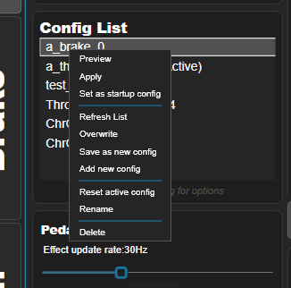

# 💻 Software Finalization

## 1️⃣ Flashing the ESP32
Connect only the USB-C cable of the PCB to the PC and flash the firmware. The servo supply stays switched off.

> [!WARNING]
> Flashing the firmware before switching on the 36 V servo supply is crucial. Otherwise the GPIOs of the ESP32 can be in an undefined state and the servo can receive random pulse and direction signals.

Now make sure you test your electronics! Electronics setup and testing is covered in [Electronics Setup](https://github.com/ChrGri/DIY-Sim-Racing-FFB-Pedal/wiki/Electronics-setup) and includes troubleshooting steps.

## 2️⃣ SimHub Plugin Configuration
When using the PCB and mechanical design from this repo, tune the SimHub plugin as suggested below.

### Regen Handling
With the external [hardware brake resistor module](https://github.com/ChrGri/Diy_Hardware_BrakeResistor), set **Regen handling** to **"Hardware brake resistor circuit only"** in the pedal settings.

In this mode the firmware
* keeps its own brake resistor output off,
* turns off the servo's internal bleeder, so the hardware circuit takes the regenerated energy,
* no longer limits the pedal speed to keep the regenerated power low.

### Pedal Configs
Ready-to-use configs for the brake and the throttle of this design are provided:

| Config | Pedal |
| :--- | :--- |
| [ChrGri_brake.json](configs/ChrGri_brake.json) | Brake, JKK60 rail with 5 mm spindle pitch |
| [ChrGri_throttle.json](configs/ChrGri_throttle.json) | Throttle, JKK60 rail with 10 mm spindle pitch |

1. **Copy the configs:** Copy both files to the SimHub config folder `C:\Program Files (x86)\SimHub\PluginsData\Common\DiyFfbPedal\configs`.
2. **Refresh list:** In the plugin, right-click the **Config List** and select **Refresh List**. The new configs appear in the list.
3. **Apply:** Right-click the config of the pedal and select **Apply**.
4. **Startup config:** Right-click the config again and select **Set as startup config**.

> [!NOTE]
> The configs already contain the pedal kinematic, the Regen handling setting and the spindle pitch. If your rail has a different spindle pitch, adjust it in the plugin.

### Pedal Kinematic
To accurately estimate the pedal force, the controller needs information about the geometric design. The values of the [current mechanical design](../MechanicalDesign_11_20215/Build/Assembly_PedalArm.md) are already included in the configs above. To check them, open the **PEDAL-KINEMATIC** tab:

| Parameter | Value |
| :--- | :--- |
| O to A | 225 |
| A to B | 72 |
| O to C | 187 |
| C to D | 0 |
| C to B | 266 |

### Travel Distance
The controller will automatically measure the travel distance. If you want it not to hit the max endstop, reduce the travel distance below the actual travel distance of the sled.
