# 🦶 Mechanical Assembly: Pedal Arm

> [!NOTE]
> This guide is provided exclusively for scientific and educational purposes. It is not intended for commercial use. Building and using the device is at your own risk. No warranty is given for accuracy, completeness, or safety; illegal or dangerous applications are expressly not intended or recommended. Parts lists are provided below so results can be reproduced for documentation and research purposes.

All parts of this guide are summarized in the [mechanical BOM](../../BOM/Mechanics/README.md). The tables in each step list the parts needed for that step.

## 📑 Table of Contents
1. [Overview & Design Choices](#overview)
2. [CAD & STL Files](#cad-stl-files)
3. [Print Settings](#print-settings)
4. [Assembly Steps](#assembly-steps)
   1. [Loadcell Arm Assembly](#loadcell-arm-assembly)
   2. [Mount iSV57 Servo to Rail](#mount-isv57-servo-to-rail)
   3. [Mount Rail to 3060 Profile](#mount-rail-to-3060-profile)
   4. [Prepare Pedal Arm](#prepare-pedal-arm)
   5. [Side Guards](#side-guards)
   6. [Faceplate to Pedal Arm](#faceplate-to-pedal-arm)
   7. [Loadcell to Pedal Arm](#loadcell-to-pedal-arm)
   8. [Attach Pedal Arm to 3060 Extrusion](#attach-pedal-arm-to-3060-extrusion)
   9. [Loadcell Arm to Sled](#loadcell-arm-to-sled)
   10. [Rail Side Covers](#rail-side-covers)
   11. [Attach 3060 Cover](#attach-3060-cover)
   12. [Attach PCB](#attach-pcb)

---

## 💡 Overview & Design Choices

### Motivation
Originally, I built my DIY FFB pedal from metal parts. After using it for some time, I became curious whether I could create a mechanical design that is mostly 3D‑printed while remaining rigid enough to withstand the heavy loads occurring in sim racing. Furthermore, I wanted to reduce the component weight, aiming for a positive impact on pedal response time. This repository documents that journey.

The 3D‑printed design has been in use since 07/2024 and shows no signs of wear in my setup.

### Problem
Metal is typically much stronger than plastic, and FDM 3D‑printed parts are generally weaker than injection‑molded counterparts.

### Solution
Create a mechanical design that takes into account the weaknesses of FDM 3D‑printed pedal parts and reinforces typical weak points:
* **Load cell joint height:** To minimize torsional forces on the vertical pedal arms during activation, the upper load cell joint is positioned at a similar height as the center of the pedal faceplate. A deeper analysis of the pedal kinematics can be found [here](https://github.com/ChrGri/DIY-Sim-Racing-FFB-Pedal/wiki/Pedal-kinematic).
* **Wide pedal arm:** The pedal arm has additional width to reduce flex when force is applied off‑center.
* **3060 base plate:** A 3060 aluminum extrusion allows direct screw‑on attachment of the linear rail guide and flexible mounting to the sim rig.

---

## 📐 CAD & STL Files
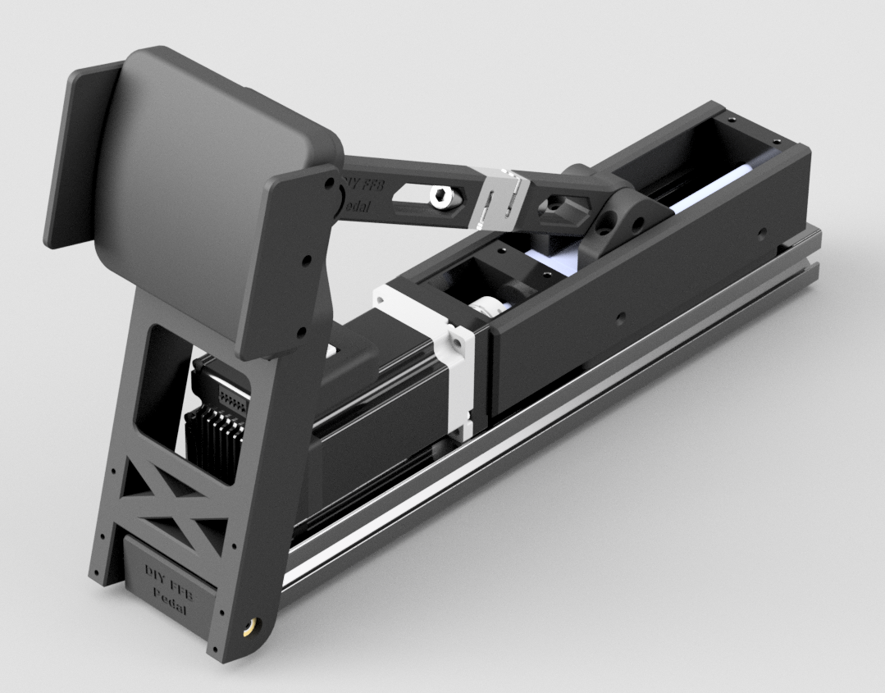  

The CAD model of the design can be found [here](CAD/DiyPedalAssemblyV3_dilatation%20v20.f3z). The STL files are linked in the assembly steps below and in the [mechanical BOM](../../BOM/Mechanics/README.md).

---

## 🖨️ Print Settings
| Material | Used for | Settings |
| :--- | :--- | :--- |
| [PETG‑CF](https://amzn.eu/d/00g90wIk) | all parts except the load cell arm adapters. The carbon fiber particles make the parts very stiff, and PETG provides good layer bonding while offering better heat resistance than PLA. | 10 perimeters, 10 top/bottom layers, 20% infill, 270 °C hotend, 70 °C bed |
| [TPE 83A](https://amzn.to/4oZeoHs) | load cell arm adapters. Absorbs system noise and vibration. | 4 perimeters, 0 top/bottom layers, 90% infill, 250 °C hotend, 70 °C bed |

---

## 🛠️ Assembly Steps

### 1️⃣ Loadcell Arm Assembly
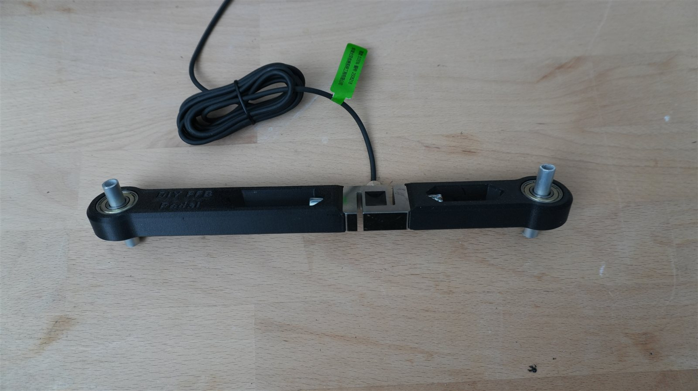  

| Part | Info | Quantity | STL | Primary link | Secondary link |
|--|--|--|--|--|--|
| DYLY‑107 load cell | see [electronics BOM](../../BOM/Electronics/README.md) | 1 | | | |
| Loadcell arm (back) | 3D print | 1 | [Loadcell arm back](STL/LoadcellArm/Loadcell-Arm-Back.stl) | | |
| Loadcell arm (front) | 3D print | 1 | [Loadcell arm front](STL/LoadcellArm/Loadcell-Arm-Front.stl) | | |
| M8×16 mm cylinder head screw | | 2 | | [link](https://amzn.to/4j2gTaD) | [link](https://s.click.aliexpress.com/e/_c30VmPrT) |
| 608‑ZZ bearing | | 2 | | [link](https://amzn.to/4pH0pak) | [link](https://s.click.aliexpress.com/e/_c4nGMZR7) |
| M8×45 mm threaded rod | | 2 | | [link](https://amzn.to/48Iyq48) | [link](https://s.click.aliexpress.com/e/_c35xCCtj) |
| PTFE (Teflon) tape | To reduce play between rod and bearing | 1 | | [link](https://amzn.to/3KzmUPj) | [link](https://s.click.aliexpress.com/e/_c3bH4vVB) |

### 2️⃣ Mount iSV57 Servo to Rail

> [!TIP]
> Servo, rail and coupler are also available as a [hardware bundle from StepperOnline](https://www.omc-stepperonline.com/de/hardware-paket-fuer-diy-aktivpedal-von-chris-empfohlen-von-l-atelier-mit-isv57t-130s-lkn60-23dl060-060-st-rc07-act-pdl?tracking=6721c5865911c) (iSV57T-130S, LKN60 rail, coupler). With the bundle, you don't need to buy the coupler and the rail below separately.

#### Attach 8mm-to-8mm Coupler to Servo
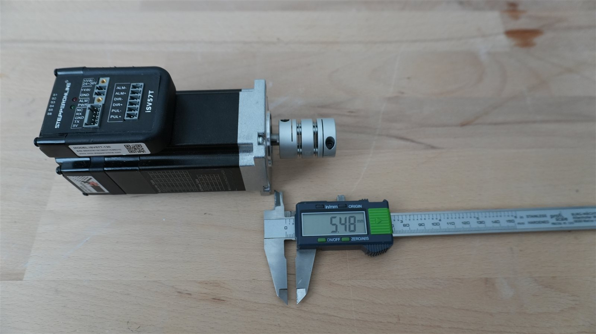  

| Part | Info | Quantity | STL | Primary link | Secondary link |
|--|--|--|--|--|--|
| 8 mm to 8 mm coupler | | 1 | | [link](https://amzn.to/4qbL1CH) | [link](https://s.click.aliexpress.com/e/_c3kPwW8h) |

Target spacing between the motor flange and the coupler is approximately 5.5 mm.

#### Attach Servo to Rail
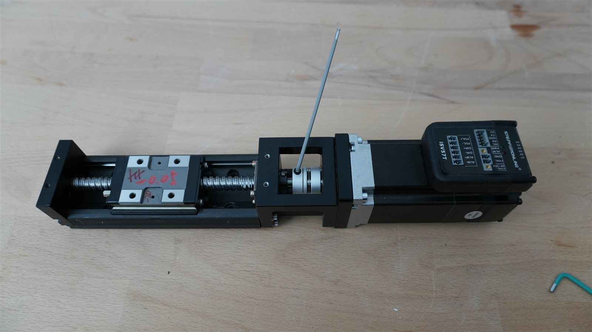  

| Part | Info | Quantity | STL | Primary link | Secondary link |
|--|--|--|--|--|--|
| KK60 linear rail | Brake: JKK60-5-C-150-A1-F4-M (5 mm pitch). Throttle: JKK60-10-P-150-A1-F4-C-M (10 mm pitch) | 1 | | [JLC link](https://jlcmc.com/product/s/B16/BQD-JKK60/steel-linear-actuators--kk60-series) | [Stepperonline link](https://www.omc-stepperonline.com/de/lkn60-kk-serie-kugelgewindetrieb-linearmodul-maximale-horizontale-vertikale-nutzlast-30kg-10kg-hub-60mm-lkn60-23dl050-060?tracking=6721c5865911c) |
| M4×16 mm cylinder head screw | | 4 | | [link](https://amzn.to/4q5GSQA) | [link](https://s.click.aliexpress.com/e/_c3bxyxud) |

### 3️⃣ Mount Rail to 3060 Profile
| | |
| :---: | :---: |
| 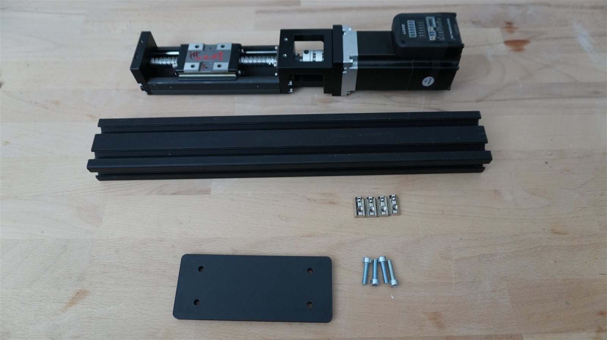 | 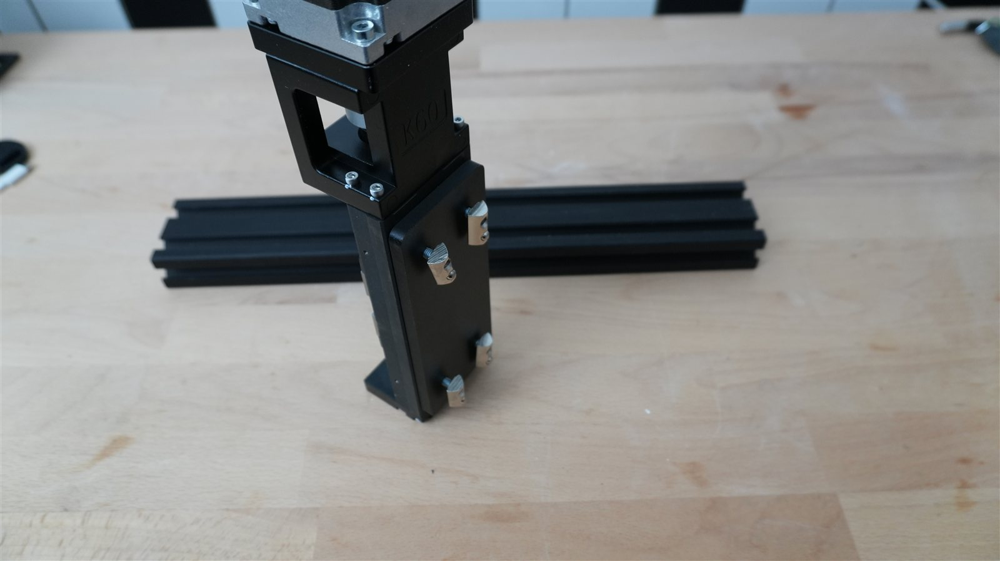 |

| Part | Info | Quantity | STL | Primary link | Secondary link |
|--|--|--|--|--|--|
| 3060 adapter plate | 3D print | 1 | [3060 adapter](STL/3060_adapter/JKK60_to_3060_adapter.stl) | | |
| 3060 extrusion | 400 mm | 1 | | [link](https://amzn.to/4aPx3Sj) | [link](https://s.click.aliexpress.com/e/_c39XbifP) |
| M5×20 mm cylinder head screw | | 4 | | [link](https://amzn.to/4j8jHD6) | [link](https://s.click.aliexpress.com/e/_c41gbyuD) |
| 3030 M5 spring ball nut | | 4 | | [link](https://amzn.to/4qffsbd) | [link](https://s.click.aliexpress.com/e/_c38nyFEZ) |

### 4️⃣ Prepare Pedal Arm
In order to increase layer strength, screws have been added across the layers.

| | |
| :---: | :---: |
| 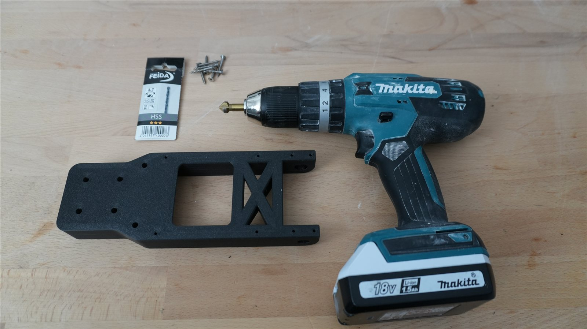 | 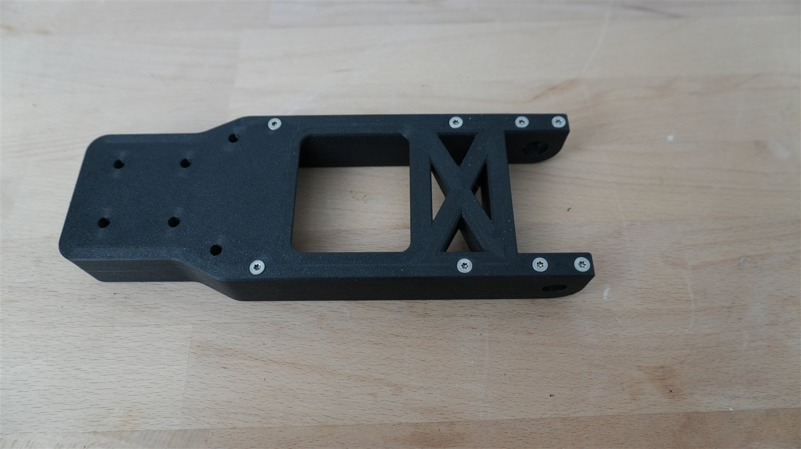 |

| Part | Info | Quantity | STL | Primary link | Secondary link |
|--|--|--|--|--|--|
| Pedal arm | 3D print | 1 | [Pedal arm](STL/PedalArm/PedalArm.stl) | | |
| Screw 3.5×30 mm | To increase layer bonding | 6 | | [link](https://amzn.to/3Xv7Wwl) | [link](https://s.click.aliexpress.com/e/_c4py0Uu1) |
| Screw 3.5×20 mm | To increase layer bonding | 2 | | [link](https://amzn.to/4nTd0p1) | [link](https://s.click.aliexpress.com/e/_c4py0Uu1) |
| Countersink set | To remove material for countersunk screws | 1 | | [link](https://amzn.to/43wEfi0) | [link](https://s.click.aliexpress.com/e/_c3yAJXfL) |

### 5️⃣ Side Guards
| | |
| :---: | :---: |
| 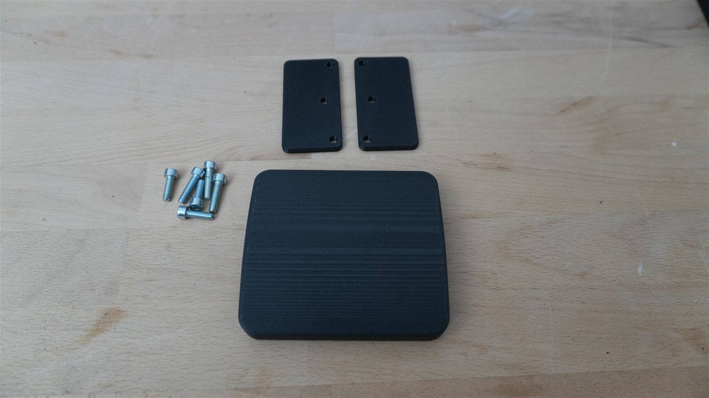 | 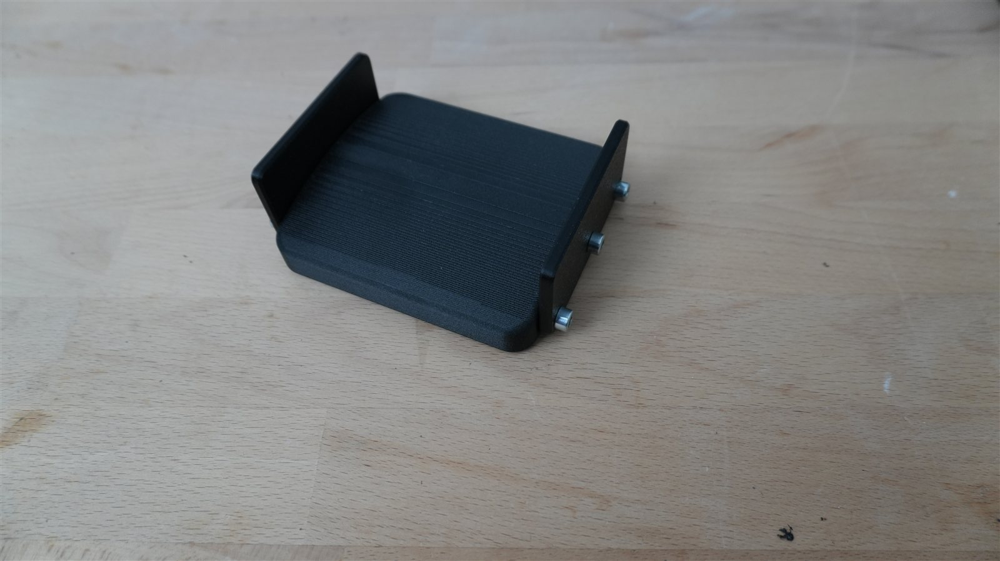 |

| Part | Info | Quantity | STL | Primary link | Secondary link |
|--|--|--|--|--|--|
| Faceplate | 3D print | 1 | [Faceplate](STL/Faceplate/Faceplate.stl) | | |
| Side guard | 3D print | 2 | [Side guard](STL/Faceplate/SideGuard.stl) | | |
| M5×20 mm cylinder head screw | | 6 | | [link](https://amzn.to/4j8jHD6) | [link](https://s.click.aliexpress.com/e/_c41gbyuD) |

### 6️⃣ Faceplate to Pedal Arm
| | |
| :---: | :---: |
| 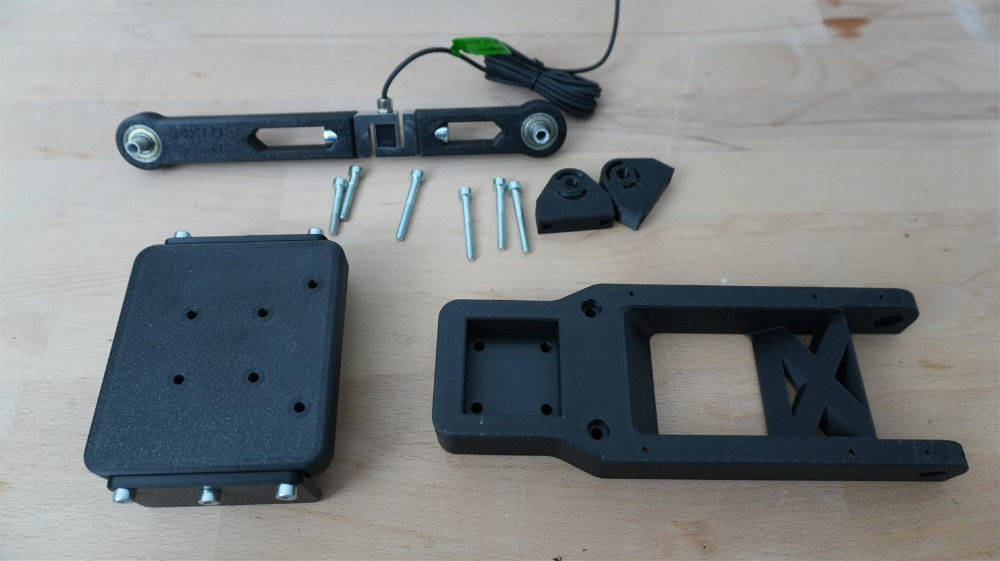 | 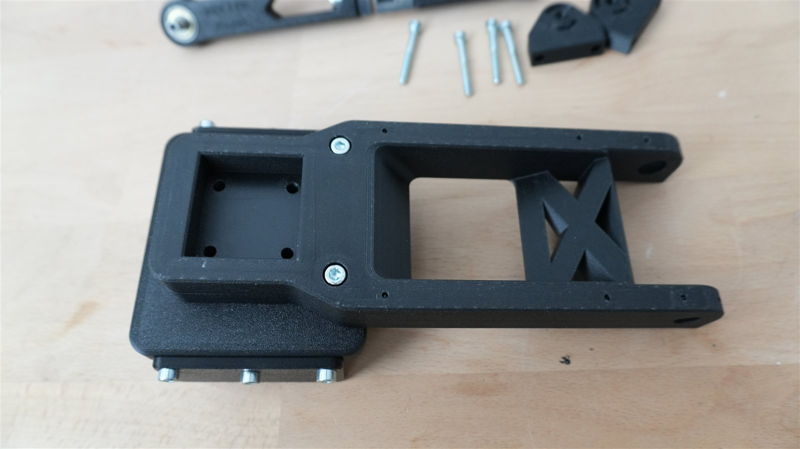 |

| Part | Info | Quantity | STL | Primary link | Secondary link |
|--|--|--|--|--|--|
| M5×30 mm cylinder head screw | | 2 | | [link](https://amzn.to/4s0iC40) | [link](https://s.click.aliexpress.com/e/_c41gbyuD) |

### 7️⃣ Loadcell to Pedal Arm
| | |
| :---: | :---: |
| 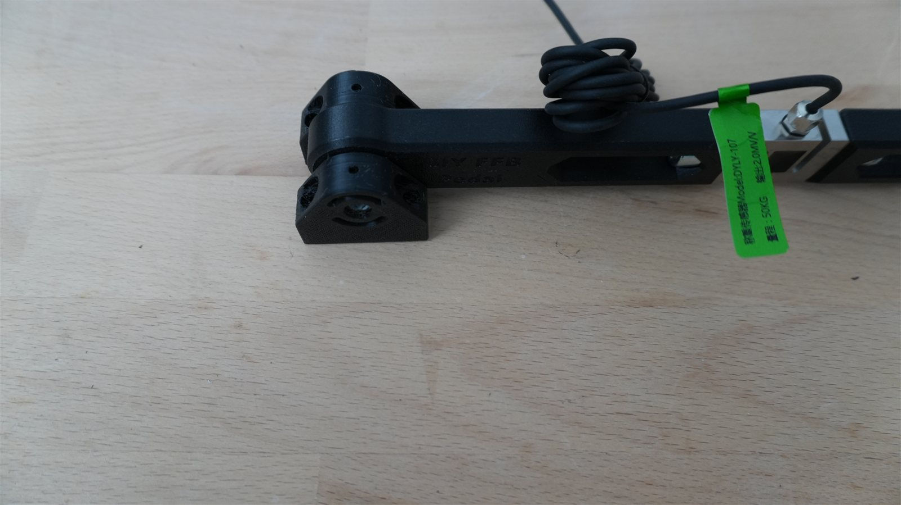 | 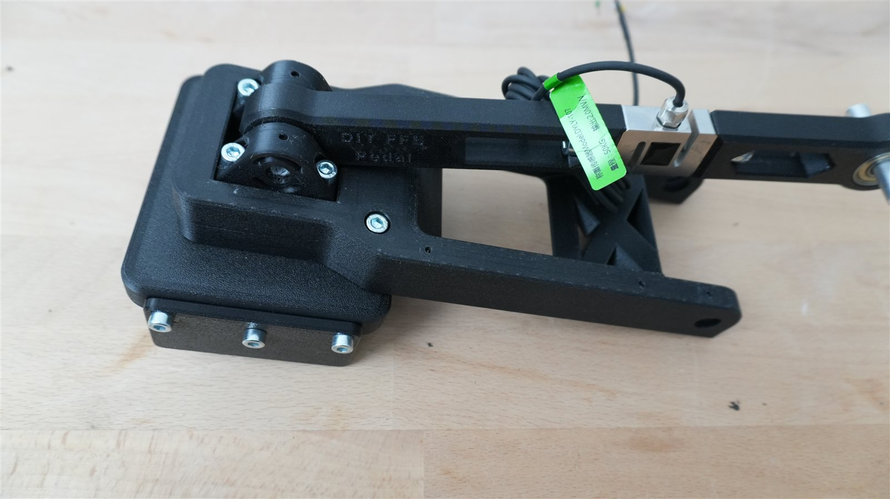 |

| Part | Info | Quantity | STL | Primary link | Secondary link |
|--|--|--|--|--|--|
| Upper loadcell arm adapter | 3D print from TPE | 2 | [Upper adapter](STL/UpperLoadcellArmAdapter/8mmUpperAdapter%20v4.stl) | | |
| M5×40 mm cylinder head screw | | 4 | | [link](https://amzn.to/3MwzAqK) | [link](https://s.click.aliexpress.com/e/_c41gbyuD) |

### 8️⃣ Attach Pedal Arm to 3060 Extrusion
| | | |
| :---: | :---: | :---: |
| 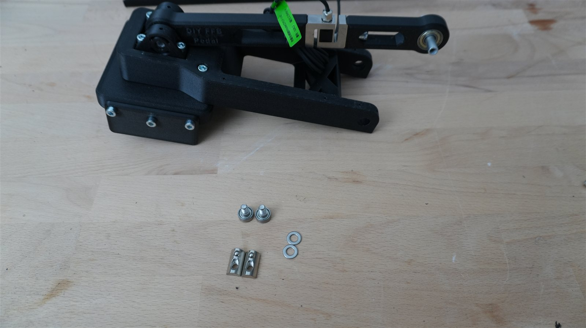 | 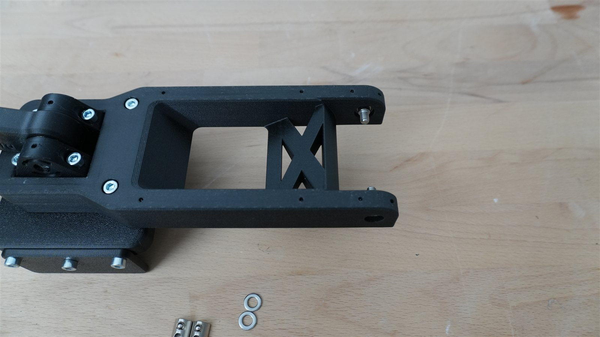 | 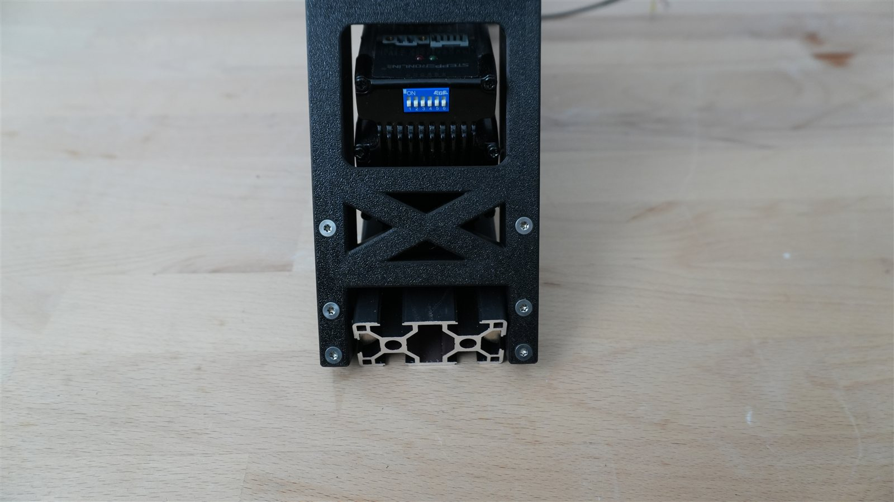 |

| Part | Info | Quantity | STL | Primary link | Secondary link |
|--|--|--|--|--|--|
| Screw bearing | JS695-13-5C3L8M6 | 2 | | | [link](https://s.click.aliexpress.com/e/_c41E25K1) |
| M6×12×1.6 mm flat washer | | 2 | | [link](https://amzn.to/3MFFq98) | [link](https://s.click.aliexpress.com/e/_c3Yqn9LL) |
| 3030 M6 spring ball nut | | 2 | | [link](https://amzn.to/4pPvLeT) | [link](https://s.click.aliexpress.com/e/_c38nyFEZ) |

### 9️⃣ Loadcell Arm to Sled
| | |
| :---: | :---: |
| 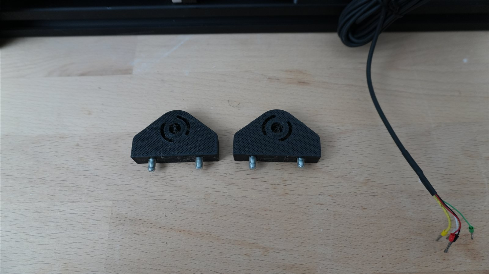 | 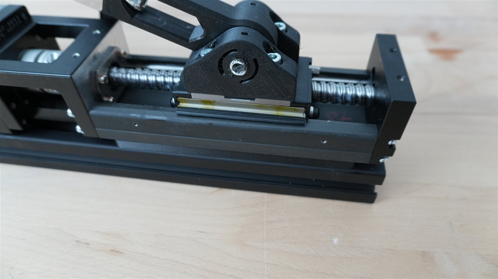 |

| Part | Info | Quantity | STL | Primary link | Secondary link |
|--|--|--|--|--|--|
| Lower loadcell arm adapter | 3D print from TPE | 2 | [Lower adapter](STL/LowerLoadcellArmAdapter/8mmLowerAdapter_v3.stl) | | |
| M5×25 mm cylinder head screw | | 4 | | [link](https://amzn.to/4s0sBpY) | [link](https://s.click.aliexpress.com/e/_c41gbyuD) |

### 🔟 Rail Side Covers
| | |
| :---: | :---: |
| 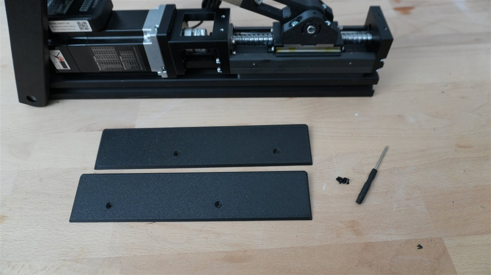 | 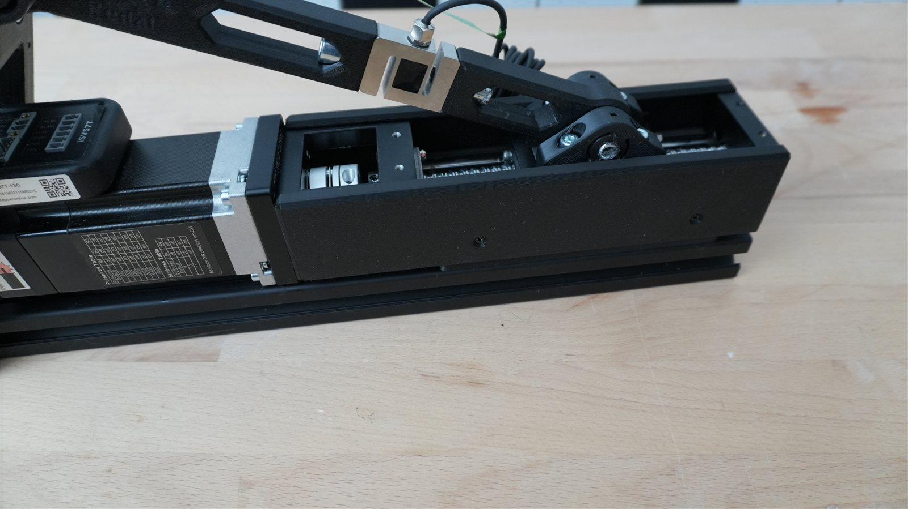 |

| Part | Info | Quantity | STL | Primary link | Secondary link |
|--|--|--|--|--|--|
| Side cover (left) | 3D print | 1 | [Cover left](STL/RailCover/Cover_left.stl) | | |
| Side cover (right) | 3D print | 1 | [Cover right](STL/RailCover/Cover_right.stl) | | |
| M2.5×6 mm countersunk screw | | 4 | | [link](https://amzn.to/3MEZUyP) | [link](https://s.click.aliexpress.com/e/_c3uZ3z3F) |

### 1️⃣1️⃣ Attach 3060 Cover
| Part | Info | Quantity | STL | Primary link | Secondary link |
|--|--|--|--|--|--|
| 3060 end cover | 3D print | 2 | [Cover](STL/3060EndCover/3060_cover.stl) | | |

### 1️⃣2️⃣ Attach PCB
The PCB V8 is mounted on the rail side cover with the PCB spacer. The electronics assembly is described [here](../../Soldering_V8).

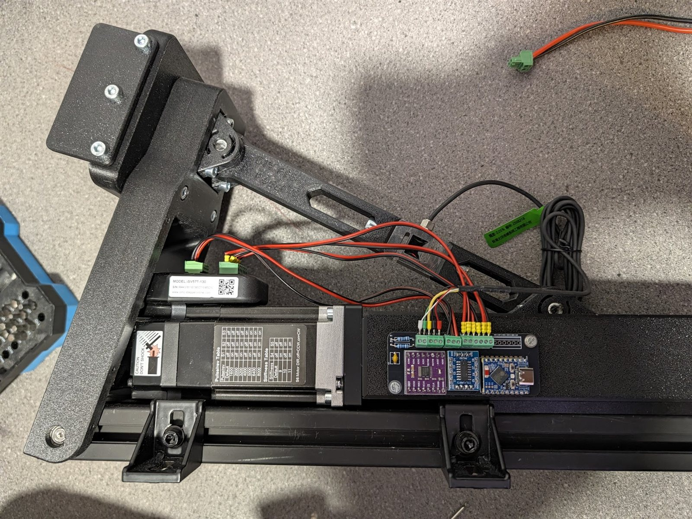  

The PCB V8 case covers the PCB on the rail. It has slots for screwdriver access to the screw terminals, an opening for the USB port and a hole for the status LED. The CAD model can be found [here](../../CAD/JKK_rail_chris/KK60_Cover_PCB_V8.solidcraft) ([STEP](../../CAD/JKK_rail_chris/PCB_Case_V8.step)).

| | |
| :---: | :---: |
| 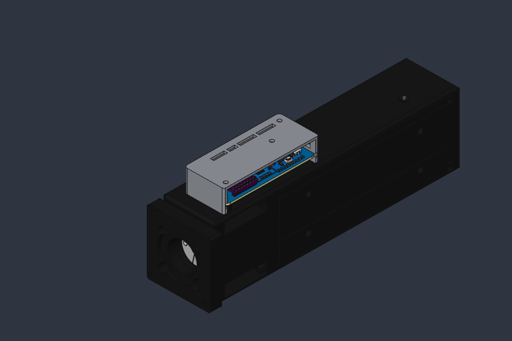 | 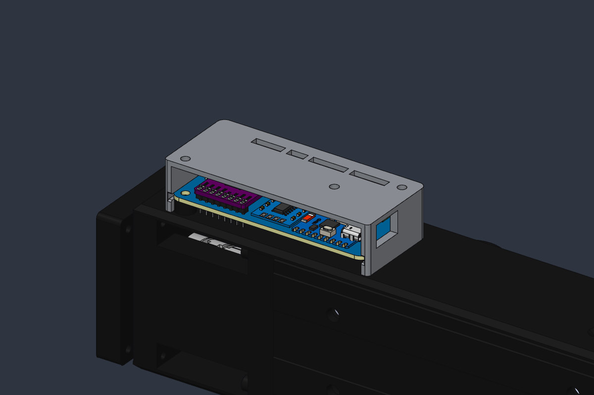 |

| Part | Info | Quantity | STL | Primary link | Secondary link |
|--|--|--|--|--|--|
| PCB spacer | 3D print | 1 | [PCB spacer](STL/RailCover/PCBSpacer.stl) | | |
| PCB V8 case | 3D print | 1 | [PCB case V8](../../CAD/JKK_rail_chris/PCB_Case_V8.stl) | | |
| M3×15 mm cylinder head screw | | 2 | | | |
