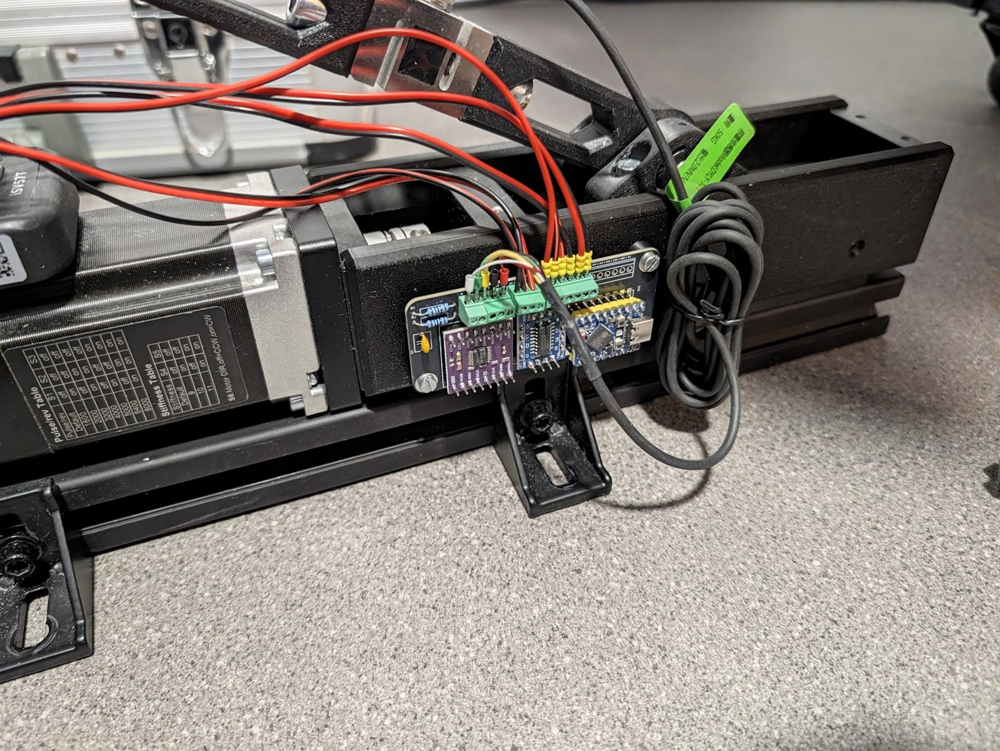
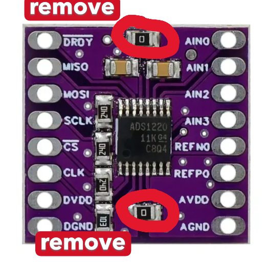
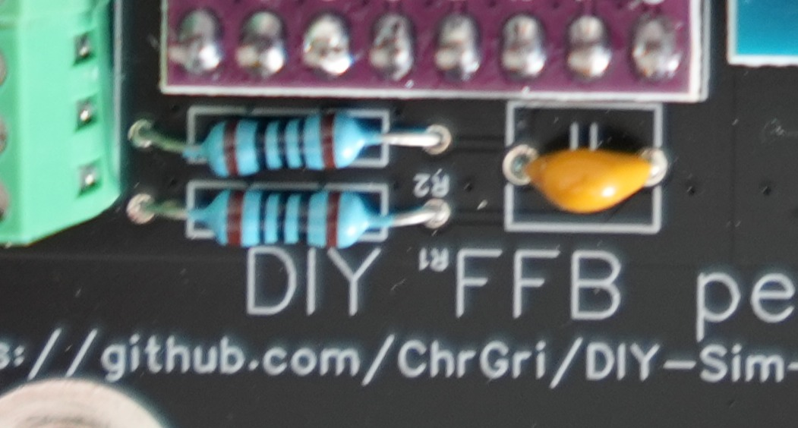

# PCB V8 Assembly

The V8 PCB is the control board of one pedal. It carries no power circuit:
* **Servo supply:** The servo is supplied directly from the external [hardware brake resistor module](https://github.com/ChrGri/Diy_Hardware_BrakeResistor). The 36 V servo supply never passes through the PCB.
* **PCB supply:** The PCB is powered (5 V) and connected to the PC via the USB-C port of the ESP32-S3 mini.

| Mounted on the pedal (top) | Mounted on the pedal (side) |
| :---: | :---: |
|  |  |

Feel free to inspect these images whenever you are unsure. The silkscreen on the PCB also shows the orientation of the modules and the label of every screw terminal.  

* **🔧 Tools:** soldering iron, side cutters, wire stripper, small screwdriver, optionally a crimping tool for the wire ferrules. I like [TS80](https://s.click.aliexpress.com/e/_olD6hiU) and [TS101](https://s.click.aliexpress.com/e/_opJpOtW) soldering irons.
* **💡 Soldering tips:** can be found [here](https://www.youtube.com/watch?v=DfC5FBsud7o).
* **📷 Photos:** Some photos below have been taken from an older PCB, but the steps apply similarly to the V8 PCB.

## 📦 Parts
The PCB gerber files can be found [here](../Wiring/PcbV8/DiyFfbPedalPcbV8.zip), see [PCB order](../PcbOrder) on how to order them.

| Part | Info | Quantity |
| ------------- | ------------- | ------------- |
| Control PCB V8 | Ordered from JLCPCB | 1 per pedal |
| ESP32 S3 mini | U13 | 1 per pedal |
| ADS1220 | load cell ADC | 1 per pedal |
| SP3232 / MAX3232 module | TTL ↔ RS232, for servo communication | 1 per pedal |
| 100 Ohm resistor | R1 and R2 of the RC filter | 2 per pedal |
| Ceramic capacitor 104 (100 nF) | C1 of the RC filter | 1 per pedal |
| 2.54 mm pitch screw terminals | 5 pin load cell, 3 pin RS232, 6 pin PUL/DIR/ALM (can be combined from 2 and 3 pin blocks) | 1 set per pedal |
| Pin header | for the modules | |
| Wire (AWG 30) | servo control and RS232 wires | ~1 m |
| Wire ferrules | for the screw terminals, optional | 9 per pedal |
| Hardware brake resistor module | see [Diy_Hardware_BrakeResistor](https://github.com/ChrGri/Diy_Hardware_BrakeResistor) | 1 per rig |

See the [electronics BOM](../BOM/Electronics/README.md) for links.

## 🛠️ Build Guide

### 1️⃣ SP3232 Assembly
Slice off a 3 and a 4 pin header from the header row and put them on the PCB.

Place the SP3232 module on the header pins next.

At first, the top pins have been soldered, afterwards the bottom pins were soldered.

### 2️⃣ ADS1220 Assembly
Correct length pin headers came with the ADS1220. Place them on the PCB.

The ADS1220 was placed on the pins next. Match the pin labels on the module with the silkscreen (AIN0 … AGND on the side facing the screw terminals).

At first, the top pins have been soldered, afterwards the bottom pins were soldered.

#### Removing the SMD Resistors
In order to allow proper function, both onboard 0 Ohm SMD resistors of the ADS1220 module have to be removed  

It was easily done by heating up the sides of the resistor quickly.

> [!WARNING]
> If not removed, loadcell reading noise is increased because digital and analog GND are not separated, and the ESP can be damaged because 5 V and 3.3 V are shorted.

### 3️⃣ RC Filter
Put the two 100 Ohm resistors through the holes R1 and R2 and solder them. After soldering, remove excessive wire from the PCB. Resistors don't have a polarity, therefore orientation is arbitrary.

Put the 104 (100 nF) ceramic capacitor through the holes of C1 and solder it. After soldering, remove excessive wire from the PCB. The capacitor doesn't have a polarity, therefore orientation is arbitrary.

### 4️⃣ ESP32-S3 Mini
Solder two rows of pin headers to the PCB and place the ESP32-S3 mini on top of them. The USB-C port has to face the outer edge of the PCB, as shown on the silkscreen and in the images above, so the USB cable can be plugged in after mounting.

At first, solder a single pin on each side and check that the module sits flat, then solder the remaining pins.

> [!TIP]
> Use female pin headers on the PCB if you want the ESP32-S3 mini to be easily removable.

### 5️⃣ Screw Terminals
Solder the 2.54 mm screw terminals to the PCB. Make sure the wire inlets face outwards, so the wires can be attached properly. From left to right:

| Terminal | Pins | Purpose |
| ------------- | ------------- | ------------- |
| Load cell | `+` `−` `G` `G` `5V` | load cell signal, GND / shield and excitation |
| RS232 | `RX` `GND` `TX` | servo debug port |
| Servo | `P+` `P−` `D+` `D−` `A+` `A−` | servo pulse, direction and alarm |
| Expansion | `D4` `D17` `D18` `3V3` `GND` `5V` | optional, not needed for the pedal |

If you don't have 5 or 6 pin terminals, combine 2 and 3 pin blocks.

### 6️⃣ Wiring
The complete wiring is shown below  

#### Load Cell
Connect the DYLY-107 load cell to the load cell terminal:

| Load cell wire | PCB terminal |
| ------------- | ------------- |
| E+ (excitation +) | `5V` |
| E− (excitation −) | `G` |
| Shield | `G` (second one) |
| S+ (signal +) | `+` |
| S− (signal −) | `−` |

> [!NOTE]
> The wire colours differ between load cells, check the label or datasheet of your load cell. If the force reading is inverted, swap `+` and `−`.

#### Servo Control Signals
Cut 6 AWG 30 wires (3 red/black pairs) to length and connect them to the servo terminal. Wire ferrules make the connection more reliable. On the other end, connect the servo control plug:

| PCB terminal | iSV57T |
| ------------- | ------------- |
| `P+` | PUL+ |
| `P−` | PUL− |
| `D+` | DIR+ |
| `D−` | DIR− |
| `A+` | ALM+ |
| `A−` | ALM− |

#### Servo RS232
Connect 3 AWG 30 wires to the RS232 terminal and to the servo debug port connector. RX and TX are crossed:

| PCB terminal | iSV57T RS232 |
| ------------- | ------------- |
| `RX` | TX |
| `GND` | GND |
| `TX` | RX |

#### Servo Power
The servo is powered directly from the [hardware brake resistor module](https://github.com/ChrGri/Diy_Hardware_BrakeResistor): PSU → SR5100 → DC IN of the MOSFET board → servo +Vdc / GND. Further pedals are connected in parallel to the same DC IN terminals. Follow the build guide in that repository.

### 7️⃣ Mounting and Power Up
Mount the PCB to the pedal as described in the [mechanical assembly](../MechanicalDesign_11_20215/Build/Assembly_PedalArm.md#attach-pcb).

Then power up the pedal in this order:
1. **Flash the firmware:** Connect only the USB-C cable to the PC and flash the firmware. The servo supply stays switched off.
2. **Unplug USB-C.**
3. **Switch on the servo supply:** Switch on the power supply of the brake resistor module.
4. **Plug in USB-C again:** The pedal connects to the servo.
5. **SimHub setting:** In the SimHub plugin, set **Regen handling** to **"Hardware brake resistor circuit only"**.

---

## ⚠️ Safety

> [!WARNING]
> - **PSU voltage:** Keep the PSU at ≤ 37 V. Above the zener threshold of the brake resistor module, the brake resistor stays switched on permanently.
> - **Polarity:** Check the polarity of all plugs, wires and screw terminals before switching on the power supply.
> - **Unplugged:** Only work on the wiring when the power supply and USB-C are unplugged.
> - **Moving pedal:** The pedal can move unexpectedly when powered. Keep your hands and feet away during the first start.
