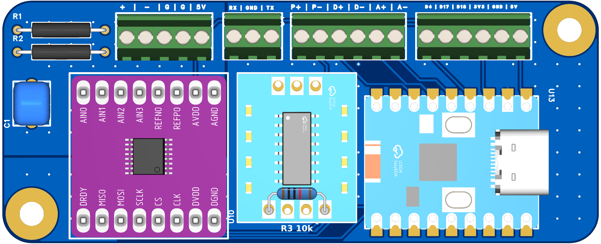
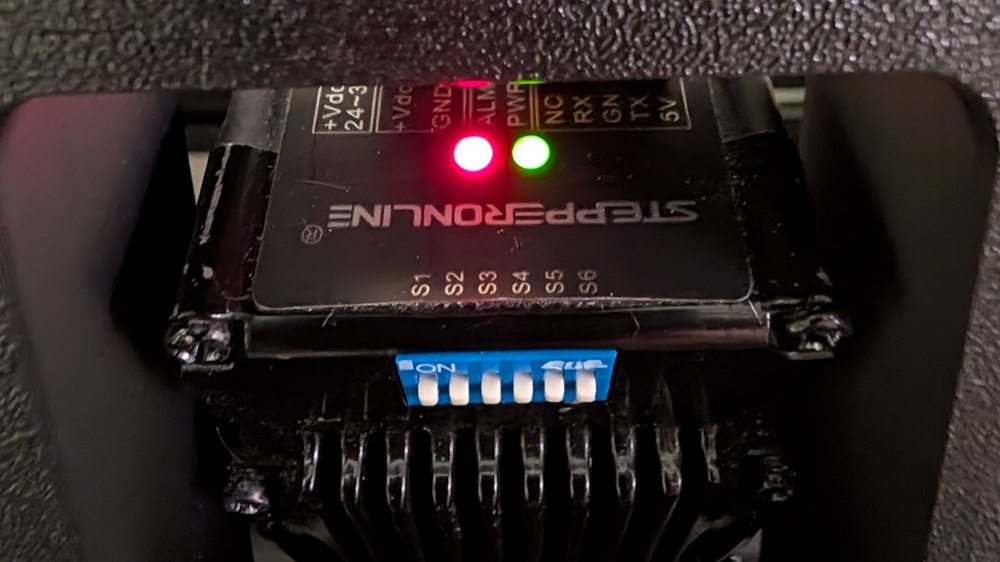
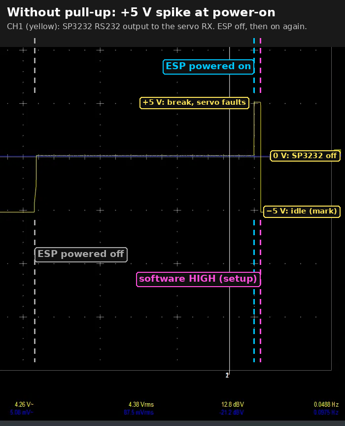
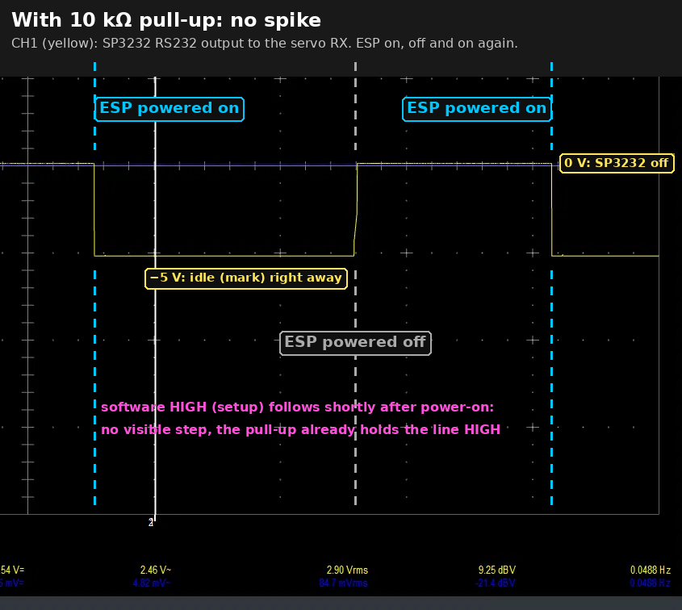
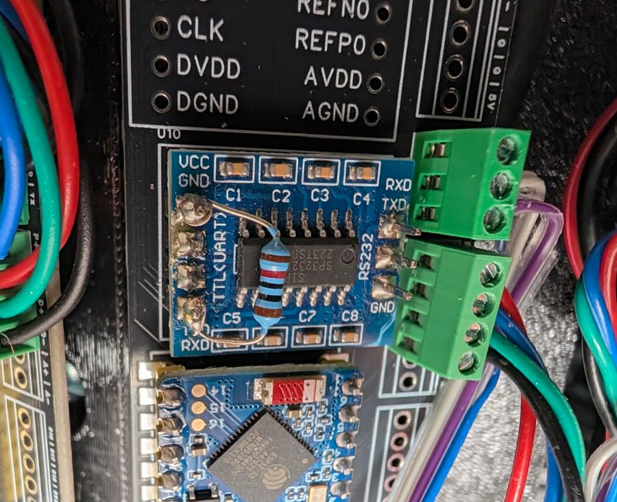

# 🔧 10 kΩ Pull-Up on the SP3232 Input (R3)

A 10 kΩ resistor from the TTL input `RXD` of the SP3232 module to `VCC` (3.3 V) keeps the iSV57 servo from going into a permanent alarm (red LED) when it is switched on. The [build guide](README.md#1️⃣-sp3232-assembly) shows how to solder it.

## ❓ Problem

Sometimes the servo started with its red ALM LED on. In this state it does not move, and homing fails. Only switching its power supply off and on again helped. It only happened while the ESP32 was powered; with the ESP32 disconnected, the servo always started normally.

*Servo with the ALM LED (red) on after power-on, next to the PWR LED (green).*

## 🔍 Cause

The ESP32 talks to the servo through the SP3232 RS232 module. The SP3232 inverts the signal:

| ESP32 TX pin (TTL) | SP3232 RS232 output → servo RX | Meaning |
| :--- | :--- | :--- |
| HIGH (3.3 V) | about −5 V | idle ("mark"): the servo starts normally |
| LOW (0 V) | about +5 V | permanent "space" / break: **the servo starts with the red LED** |

Tests with a sketch that only sets fixed pin levels (no communication at all) showed: if the servo RX sees +5 V while the servo boots, it goes into the alarm. With −5 V it starts normally.

The firmware sets the TX pin HIGH at the very beginning of `setup()`. But between powering on (or resetting) the ESP32 and that line, the ESP32 runs its ROM bootloader, second stage bootloader and the Arduino start-up. During this time the TX pin is an undriven input. The SP3232 already runs and reads it as LOW, so it drives **+5 V** to the servo RX until `setup()` sets the pin HIGH. The same happens while the ESP32 is flashed or if the firmware does not start.

*Without pull-up. CH1 (yellow): SP3232 RS232 output to the servo RX. After the ESP32 is powered on, the output jumps to +5 V until the firmware sets the TX pin HIGH.*

If the servo boots during this time, e.g. when the PC (USB) and the servo supply are switched on together, or the servo supply rises slowly behind an inrush current limiter, it sees the break and goes into the alarm.

Firmware cannot fix this: no application code runs before `setup()`. It could only make the time shorter (custom bootloader hook), not remove it.

## ✅ Solution

A 10 kΩ pull-up from the SP3232 TTL input `RXD` (= ESP32 TX, GPIO 5 on the V8) to `VCC` (3.3 V) holds the input HIGH while the ESP32 pin is undriven. The SP3232 then outputs −5 V (idle) from the first moment it has power. In operation the UART drives the pin, the pull-up does not disturb the communication.

*With the 10 kΩ pull-up. The output goes straight from 0 V (SP3232 off) to −5 V (idle) when the ESP32 is powered on. No spike to +5 V.*

*Pull-up soldered on the SP3232 module (photo of a V7 PCB, the module and its pins are the same on the V8).*

## 📐 Details

* **Value:** 10 kΩ (4.7 kΩ … 10 kΩ work), any 1/4 W through-hole resistor.
* **Pins on the V8 PCB** (4 pin TTL row of the SP3232, from left to right as seen in the render, checked against the Gerber files):

| Pad | Net | Module label |
| :--- | :--- | :--- |
| 1 (left) | 3.3 V | `VCC` ← resistor |
| 2 | GND | `GND` |
| 3 | ESP32 GPIO 6 (ESP32 RX) | `TXD` |
| 4 (right) | ESP32 GPIO 5 (ESP32 TX) | `RXD` ← resistor |

* **VCC must be 3.3 V.** On the V8 PCB the module is supplied with 3.3 V. Never pull the ESP32 pin to 5 V.
* **Alternative position:** between ESP32 GPIO 5 and 3V3, or on the bottom side of the PCB between the two pads; electrically it is the same.
* **Without the resistor:** switch the servo supply on a few seconds after the PC, or switch the servo off and on again if its red LED is on.
