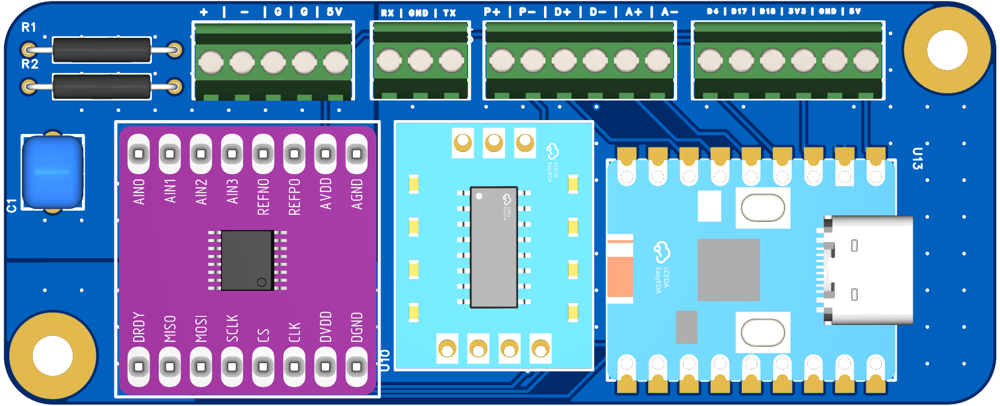
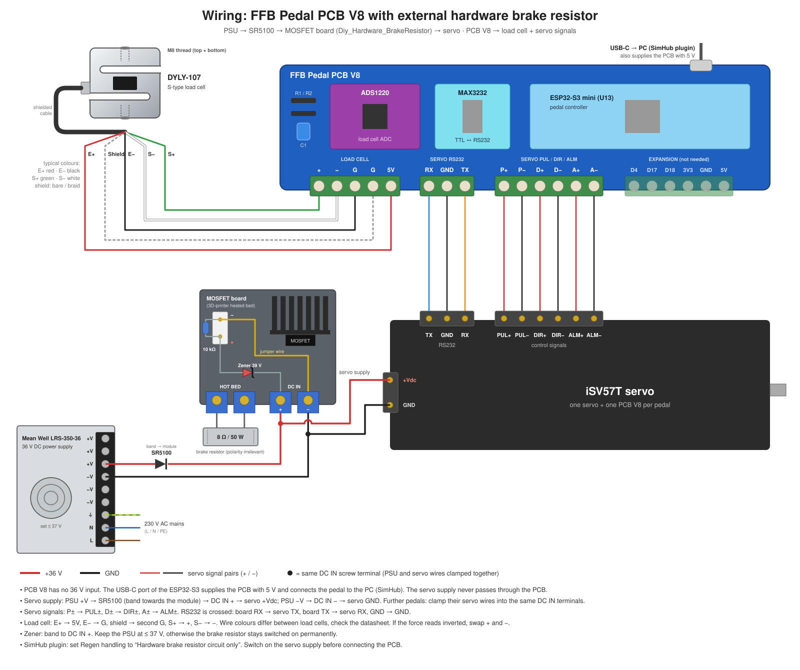

# 🖥️ Control PCB V8

The control PCB of one pedal. It holds the ESP32-S3 mini, the ADS1220 load cell ADC and the SP3232 RS232 module. The PCB has no power circuit: the servo is supplied directly from the [hardware brake resistor module](https://github.com/ChrGri/Diy_Hardware_BrakeResistor), the PCB is powered via USB-C.

## 📁 Files

| File | Content |
| :--- | :--- |
| [DiyFfbPedalPcbV8.zip](DiyFfbPedalPcbV8.zip) | Gerber files, see [PCB order](../../PcbOrder) |
| [wiring_diagram.svg](wiring_diagram.svg) | Wiring diagram |
| [PCB_V8_3D.png](PCB_V8_3D.png) | 3D render |

## 🔌 Screw Terminals

From left to right, as printed on the PCB:

| Terminal | Pins | Connects to |
| :--- | :--- | :--- |
| Load cell | `+` `−` `G` `G` `5V` | S+, S−, E−, shield, E+ of the load cell |
| RS232 | `RX` `GND` `TX` | servo RS232 TX, GND, RX (RX and TX crossed) |
| Servo | `P+` `P−` `D+` `D−` `A+` `A−` | servo PUL+, PUL−, DIR+, DIR−, ALM+, ALM− |
| Expansion | `D4` `D17` `D18` `3V3` `GND` `5V` | optional, not needed for the pedal |

## 📐 Wiring Diagram

The assembly guide can be found [here](../../Soldering_V8).
